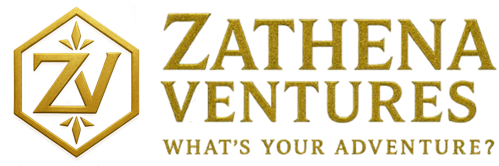
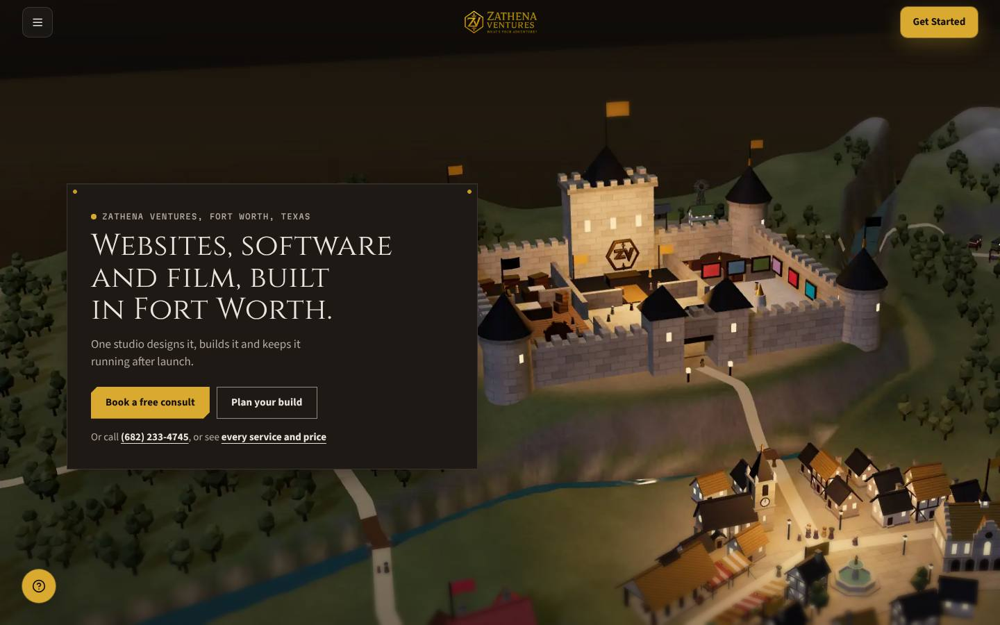
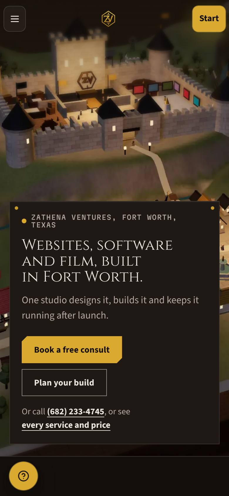

  

<h1 align="center"><a href="https://zathenaventures.xyz">Zathena Ventures</a></h1>

  Zathena Ventures is a studio in Fort Worth, Texas that builds websites, software and film, then keeps them running after launch. It is also the central hub of a family of brands: every connected brand, product and service is reached from here. The website itself is a 3D model on a table, a castle with its roofs off and a town at its gate, where each page is a room and each brand has a place of its own.

  <strong>Live site:</strong> <a href="https://zathenaventures.xyz">zathenaventures.xyz</a>

  <a href="#what-it-is">What it is</a> · <a href="#services">Services</a> · <a href="#features">Features</a> · <a href="#products">Products</a> · <a href="#team">Team</a> · <a href="#book-or-get-in-touch">Book</a> · <a href="#connected-brands">Connected brands</a>

  
  
  
  

<table>
  <tr>
    <td align="center" valign="top"> Desktop: the castle and town at night, with the two ways forward up front.</td>
    <td align="center" valign="top"> Mobile: the same home page on a phone.</td>
  </tr>
</table>

## What it is

Zathena Ventures is the umbrella company that ties the whole ecosystem together. One studio designs the work, builds it and stays on after launch to keep it running, so a client deals with the same people from the first call to the hundredth update.

The site is where all of it meets. Services and prices for websites, software, platforms, automation, visibility, brand and consulting sit next to the film, music, podcast and games brands. One cart covers services and merch. One member account works across the studio's sites. Every connected brand has a door on the home page and a place on the map.

It is also the proof. The site is built the way the studio builds for clients: a full 3D world for anyone who wants it, a still image for anyone on a slow connection or with motion reduced, and plain readable HTML on every page.

## Services

The studio's own services, each with its price or starting price on the [Services](https://zathenaventures.xyz/services) and [Pricing](https://zathenaventures.xyz/pricing) pages:

- **[Web design](https://zathenaventures.xyz/services/web-design)**: websites designed and built by the studio and looked after once they are live.
- **[Full-stack development](https://zathenaventures.xyz/services/full-stack)**: complete web applications, front to back.
- **[Advanced development](https://zathenaventures.xyz/services/advanced-development)**: larger custom software builds.
- **[CRM solutions](https://zathenaventures.xyz/services/crm-solutions)**: customer management set up around how a team actually works, built on the studio's own CRM.
- **[Digital strategy](https://zathenaventures.xyz/services/digital-strategy)**: planning what to build and how people will find it.
- **[Video production](https://zathenaventures.xyz/services/video-production)**: film and video for brands and events.

The service index groups everything into [websites](https://zathenaventures.xyz/services#services-websites), [software](https://zathenaventures.xyz/services#services-software), [platforms](https://zathenaventures.xyz/services#services-platform), [automation](https://zathenaventures.xyz/services#services-automation), [visibility](https://zathenaventures.xyz/services#services-visibility), [brand](https://zathenaventures.xyz/services#services-brand), [consulting](https://zathenaventures.xyz/services#services-consulting) and [media](https://zathenaventures.xyz/services#services-media), with bundles and card checkout.

Across the connected brands:

- **Film, photography and sound** through [ZV Media](https://zvmedia.xyz/services/): event coverage, music videos, brand and product shoots, real estate, portraits, podcast and music production, editing and writing.
- **Games built to order** through [ZV Labs](https://zvlabs.xyz/build), from a brief to a launch page.
- **Walkable 3D experiences** like [The Zathena Gallery](https://app.zathenaventures.xyz), where visitors enter the ZV world as an avatar instead of scrolling a page.
- **Landing pages for partner brands**, such as [MTV Weddings](https://mtvweddings.com), whose media is made through ZV Media and whose pages are built here.

Not sure where to start? [Get started](https://zathenaventures.xyz/get-started) or [book a free consult](https://zathenaventures.xyz/contact?book=consult).

## Features

### The world on the table
- **A castle you can look into**: the roofs are off, so the great hall, workshop, gallery, treasury, council chamber and gatehouse are each a page of the site.
- **A place for every brand**: a studio lot, an amphitheatre, a fairground, a crossroads inn, a museum, a lighthouse, a trade city and a ranch ring the town, each in its own colour.
- **Travel instead of page loads**: the camera follows the page as it scrolls and flies to the next place when the page changes. Back and forward fly the same route in reverse.
- **Day and night**: the theme switch turns a brass hoop carrying the sun and moon, the light changes and the windows come on.
- **Residents who notice you**: they look toward the pointer, step aside, gather where the table is clicked and hurry when the page scrolls fast.
- **Map names that are real links**: every place on the map is also a plain link on the page and in the menu.
- **Works without the 3D**: a still of every place, by day and by night, for the first paint and for anyone with reduced motion, data saving on or no 3D support.

### For people hiring the studio
- **Home in one line**: what the studio does, live figures, the service index, live work and every brand as a door.
- **Two ways forward on every screen**: book a free consult, or plan the build.
- **Plan your build**: tick what you are launching, watch the site assemble itself, then send the plan or book the call.
- **Work as it is today**: live client sites in a grid, a list or a wall, with a case study for each project a client has agreed to share.
- **Booking that holds the slot**: pick a time from live availability and cancel from a link in the email. Other studio sites can offer the same call from inside their own pages.

### For members and fans
- **Media in one place**: the film, music, podcast and games brands, each opening in a window without leaving the site.
- **One shop**: merch across the brands and services in a single cart.
- **One account**: a profile, a forum and groups, courses and membership, shared across the studio's sites.

### On every page
- **Built for everyone**: day and night mode, site search, an accessibility menu, a help panel and back to top.
- **A screensaver** where every logo on screen is a different brand, and they bounce off each other.

## Products

- **[Zathena Ventures website](https://zathenaventures.xyz)**: the hub described above, where services are sold and every brand is reached.
- **Zathena Ventures CRM**: the operations platform the studio runs on. People, companies, deals, projects, tasks, support and communications sit in one place, owned outright instead of rented from a subscription service. It is for the team only, and the same approach is offered to clients through [CRM solutions](https://zathenaventures.xyz/services/crm-solutions).
- **[The Zathena Gallery](https://app.zathenaventures.xyz)**: the 3D side of Zathena Ventures. You walk in as an avatar, explore a wing for each brand and open any exhibit onto the live work. Showcase: [3DZathenaVentures-Public](https://github.com/ZATHENA-VENTURES/3DZathenaVentures-Public).

## Team

Meet the studio on the [team page](https://zathenaventures.xyz/team), and see open roles on [careers](https://zathenaventures.xyz/careers).

**Michael B. Hughes-Isbell** ([michaelbisbell.com](https://michaelbisbell.com)) is part of the Zathena Ventures ecosystem with his own brand, and is a co-founder of [Trinity Holistic Healing](https://thetrinityholistichealing.com).

## Book or get in touch

- **[Book a free consult](https://zathenaventures.xyz/contact?book=consult)** from live availability.
- **[Contact](https://zathenaventures.xyz/contact)**: one form, plus the phone, inbox and city.
- **[FAQ](https://zathenaventures.xyz/faq)** and **[reviews](https://zathenaventures.xyz/reviews)** if you want to read first.

## Connected brands

- **[3D Zathena Ventures](https://app.zathenaventures.xyz)**: The Zathena Gallery, the ZV world you walk through as an avatar.
- **[ZV Media](https://zvmedia.xyz)**: film, video, photography and sound, now its own brand.
- **[ZV Labs](https://zvlabs.xyz)**: games, now its own brand.
- **[ZADAN](https://zadan.xyz)**: singer-songwriter.
- **[The Wednesday Wanderer](https://twwpodcast.xyz)**: weekly podcast hosted by ZADAN.
- **[Michael B. Hughes-Isbell](https://michaelbisbell.com)**: Michael's own portfolio brand.
- **[MTV Weddings](https://mtvweddings.com)**: weddings and officiation in Fort Worth and DFW, with media by ZV Media and pages by Zathena Ventures.
- **[Trinity Holistic Healing](https://thetrinityholistichealing.com)**: therapy and wellness in Fort Worth, co-founded by Michael B. Hughes-Isbell.
- **[Zathena Valley](https://farm.zathenaventures.xyz)**: a farm in Crowley, Texas raising quail and building healthy soil. It is a separate farm business, not a digital one, and it is not on the shared accounts or shared profiles used by the other brands.

Client sites built and hosted by the studio: [New Covenant University](https://github.com/ZATHENA-VENTURES/NCU-Public), [JR Blades](https://github.com/ZATHENA-VENTURES/JRBlades-Public), [Sound Ground](https://github.com/ZATHENA-VENTURES/SoundGround-Public), [Terah Marie](https://github.com/ZATHENA-VENTURES/TerahMarie-Public), [Mumbo Vibes](https://github.com/ZATHENA-VENTURES/MumboVibes-Public), [Raver Realm](https://github.com/ZATHENA-VENTURES/RaverRealm-Public), [The Autistic Aquarian](https://github.com/ZATHENA-VENTURES/AutisticAquarian-Public), [Delphi](https://github.com/ZATHENA-VENTURES/Delphi-Public) and [Sabina Was Here](https://github.com/ZATHENA-VENTURES/SabinaWasHere-Public).

## License

© 2026 Zathena Ventures. All rights reserved.

## Credits & Contact

- **Live site:** [zathenaventures.xyz](https://zathenaventures.xyz)
- **Contact:** [zathenaventures.xyz/contact](https://zathenaventures.xyz/contact)
- **Built and hosted by:** Zathena Ventures, Fort Worth, Texas

> This is the public showcase of a private repository. It presents the project, its features and its live site, and leaves out source code and deployment details.
